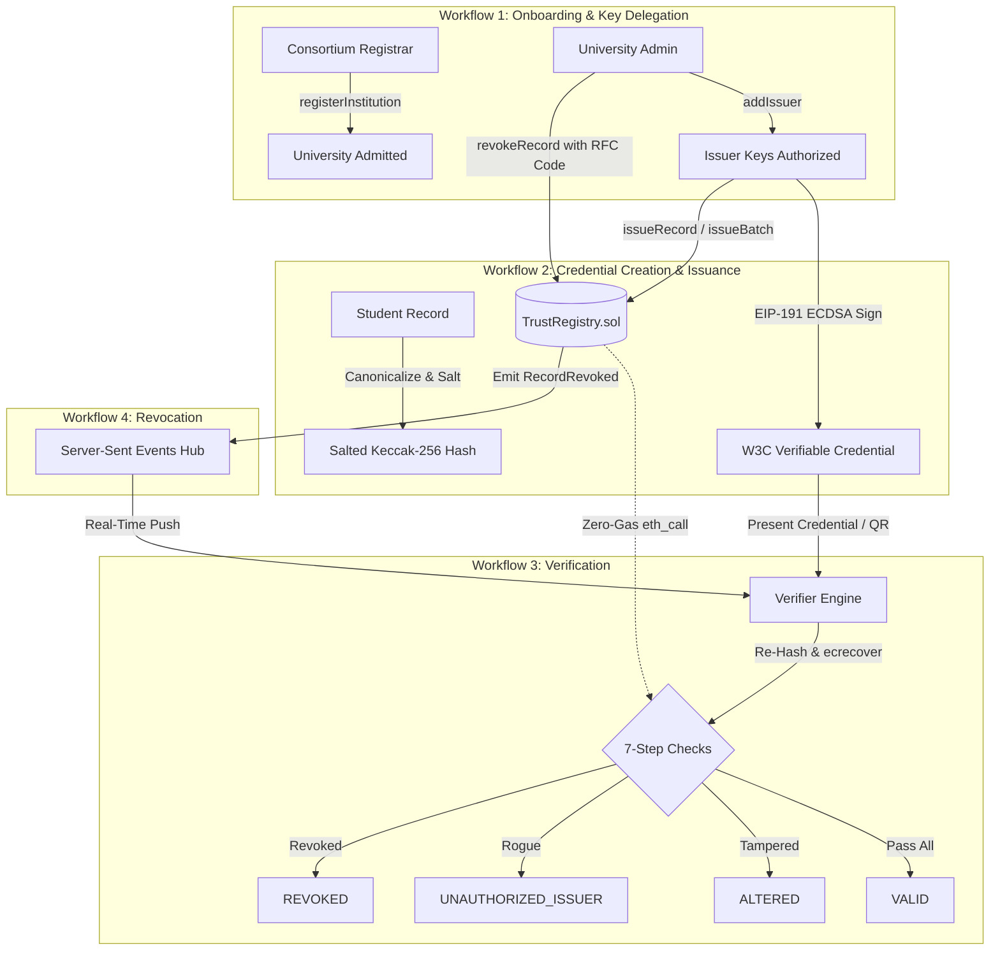
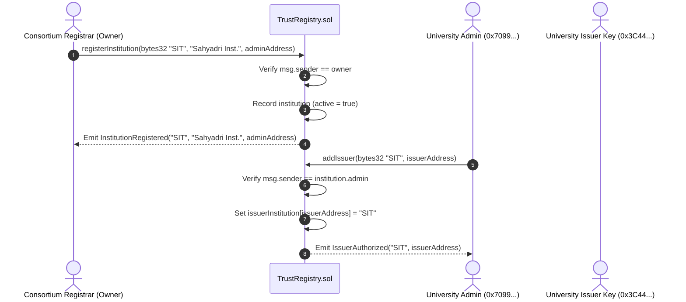
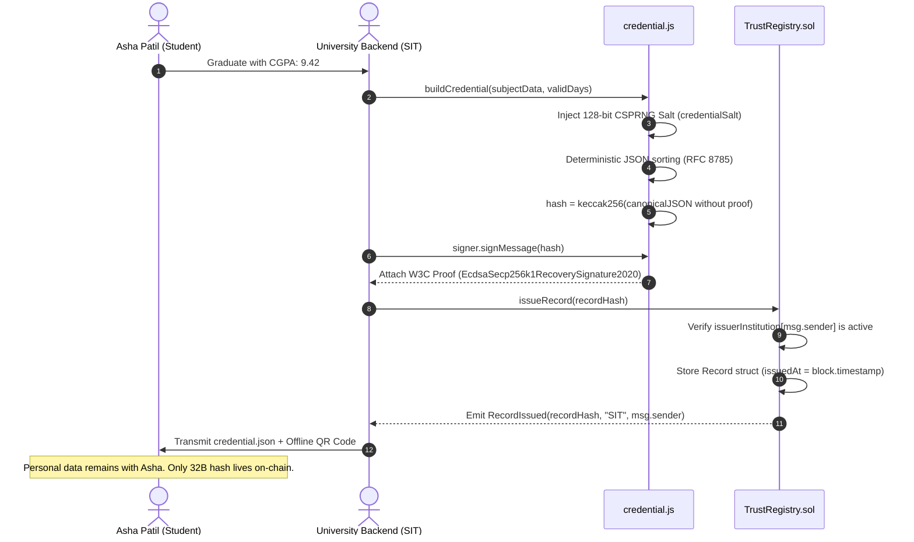
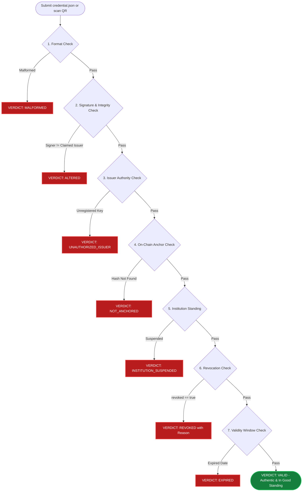

# VeriTrust: Complete System Architecture, Workflows & UI Manual
## Exhaustive Technical Reference for INNOVISE 2026 (Problem Statement 2)

---

## Table of Contents
1. [Executive Summary & Problem Space](#1-executive-summary--problem-space)
2. [Component-by-Component UI Architecture (Every Tab & Div)](#2-component-by-component-ui-architecture)
   - [Global Top Bar & Institutional Persona Switcher](#global-top-bar--institutional-persona-switcher)
   - [Tab 1: Overview (Hero, 3D Coverflow, Tilt Grid, 6 Pillars)](#tab-1-overview-home)
   - [Tab 2: Verify (Radar Loader, 7-Step Chain of Trust, Mobile QR)](#tab-2-verify-credential-verification-engine)
   - [Tab 3: Tamper Lab (Strict Avalanche Workbench & Bit Diff)](#tab-3-tamper-lab-cryptographic-avalanche-workbench)
   - [Tab 4: Issuance Console (Single & Cohort Calldata Batch)](#tab-4-issuance-console-single--cohort-calldata-batch)
   - [Tab 5: Revocations (Scoped Authority & RFC Reason Codes)](#tab-5-revocations-cryptographic-revocation-management)
   - [Tab 6: Consortium (Institutional Topology & Audit Trail)](#tab-6-consortium-institutional-topology--audit-trail)
   - [Tab 7: Analytics (Native SVG Telemetry & Gas Metrics)](#tab-7-analytics-real-time-telemetry--gas-benchmarks)
   - [Tab 8: Benchmarks (8 Scripted Evaluator Scenarios)](#tab-8-benchmarks-evaluator-scenarios-suite)
3. [The 7 End-to-End Operational Workflows](#3-the-7-end-to-end-operational-workflows)
   - [Workflow 1: Institutional Onboarding & Key Delegation](#workflow-1-institutional-onboarding--key-delegation)
   - [Workflow 2: Credential Creation, Salting, Signing & Anchoring](#workflow-2-credential-creation-salting-signing--anchoring)
   - [Workflow 3: Cohort Batch Issuance (~68.9% Gas Savings)](#workflow-3-cohort-batch-issuance-689-gas-savings)
   - [Workflow 4: Trustless 7-Step Verification (< 50ms, Zero Gas)](#workflow-4-trustless-7-step-verification--50ms-zero-gas)
   - [Workflow 5: Tamper Attempt & Strict Avalanche Detection](#workflow-5-tamper-attempt--strict-avalanche-detection)
   - [Workflow 6: Scoped Revocation & Real-Time Multi-Window SSE Sync](#workflow-6-scoped-revocation--real-time-multi-window-sse-sync)
   - [Workflow 7: Resilient Key Rotation & Compromised Key Recovery](#workflow-7-resilient-key-rotation--compromised-key-recovery)
4. [Cryptographic Specifications & Mathematical Formulations](#4-cryptographic-specifications--mathematical-formulations)
5. [Smart Contract State & Error Reference (`TrustRegistry.sol`)](#5-smart-contract-state--error-reference)

---

## 1. Executive Summary & Problem Space

### 1.1 The Core Trilemma
Traditional verification relies either on **centralized databases** (which create multi-million student PII honeypots vulnerable to data breaches) or on **slow manual peer-to-peer verification** (taking 2 to 6 weeks and costing $30–$100 per check).

**VeriTrust** solves this by establishing a **hybrid cryptographic architecture**:
1. **Off-Chain Sovereign Data Holding:** The complete credential containing sensitive personal data (student name, degree, GPA) remains exclusively off-chain with the holder as a standardized W3C Verifiable Credential.
2. **On-Chain Cryptographic Anchoring:** Only an anonymized 32-byte salted hash (`keccak256`) is stored on an EVM smart contract ([`TrustRegistry.sol`](file:///f:/Vjti%20Aryan/veritrust/contracts/TrustRegistry.sol)).
3. **Instant Trustless Verification:** Any relying party can verify authenticity, authority, tampering, and revocation in under **50 milliseconds** using zero-gas read-only calls (`eth_call`).

```
                              HIGH-LEVEL DATA MODEL
┌────────────────────────────────────────┐       ┌──────────────────────────────────────┐
│ OFF-CHAIN (Holder Sovereign Storage)   │       │ ON-CHAIN (EVM Trust Registry)        │
│ • Student Name: Asha Patil             │       │ • bytes32 recordHash (Salted Fingerprint)
│ • Degree: B.Tech Computer Engineering  │ ───►  │ • bytes32 institutionId ("SIT")      │
│ • CGPA: 9.42 / 10                      │       │ • address issuer (Authorized Key)    │
│ • 128-bit CSPRNG Salt (Entropy)        │       │ • uint64 issuedAt / revokedAt        │
│ • ECDSA secp256k1 Signature (Proof)    │       │ • uint8 reason (RFC Revocation Code) │
└────────────────────────────────────────┘       └──────────────────────────────────────┘
      (Zero PII on the Blockchain)                  (Immutable Public Cryptographic Proof)
```

---

## 2. Component-by-Component UI Architecture

```
                                  VERITRUST UI TOPOLOGY
 ┌──────────────────────────────────────────────────────────────────────────────────────────┐
 │ HEADER NAV: Logo • Active Tab Indicator • Live Block Ribbon (SSE) • Persona Switcher     │
 ├──────────────────────────────────────────────────────────────────────────────────────────┤
 │ TAB 1: OVERVIEW      Hero Section • Proof Aside • 3D Coverflow • 3D Tilt Grid • 6 Pillars │
 │ TAB 2: VERIFY        JSON Editor • 2.2s Radar Loader • 7-Step Chain of Trust • Mobile QR │
 │ TAB 3: TAMPER LAB    CGPA Slider • Live SAC Bit Variance • Hex Diff • Real-Time Fail     │
 │ TAB 4: ISSUANCE      Single Credential Form • Cohort CSV Batch • Gas Matrix Calculator   │
 │ TAB 5: REVOCATIONS   Records Table • Scoped Authority Guard • RFC Reason Selector       │
 │ TAB 6: CONSORTIUM    Institutional Network Map • Event-Driven On-Chain Audit Trail       │
 │ TAB 7: ANALYTICS     Records Bar Chart • Outcomes Donut • Gas Comparison • Reasons       │
 │ TAB 8: BENCHMARKS    8-in-1 Evaluator Scenario Suite with Live Contract State Reverts    │
 └──────────────────────────────────────────────────────────────────────────────────────────┘
```

### Global Top Bar & Institutional Persona Switcher
- **Brand Element:** Glowing emerald shield icon with real-time pulsing status beacon.
- **Center Navigation Pill ([`HeaderNav.tsx`](file:///f:/Vjti%20Aryan/veritrust/atelier-ui-codrops-main/src/components/HeaderNav.tsx)):** Houses tabs with a spring-animated active tab indicator (`layoutId="activeTabBadge"`).
- **Live Block Indicator:** Displays `Block #N`, auto-incrementing in real time via Server-Sent Events ([`events.js`](file:///f:/Vjti%20Aryan/veritrust/src/events.js)) whenever a new block is mined.
- **Institutional Identity Modal ([`AuthModal.tsx`](file:///f:/Vjti%20Aryan/veritrust/atelier-ui-codrops-main/src/components/AuthModal.tsx)):**
  Allows evaluators to switch roles on the fly:
  - **Consortium Registrar (`0xf39F...`):** Can register and suspend institutions.
  - **Sahyadri Institute Admin (`0x7099...`):** Controls SIT issuer keys.
  - **SIT Registrar Office (`0x3C44...`):** Authorized SIT issuing key.
  - **SIT Exam Cell (`0x90F7...`):** Authorized SIT issuing key.
  - **Konkan State Univ Admin (`0x15d3...`):** Controls KSU keys.
  - **Unregistered Degree Mill (`0x976E...`):** Attacker persona.

---

### Tab 1: Overview (Home)
1. **Hero Section (`.ledger-hero`):**
   - Displays *"Trust records. Not databases."*
   - Three quick-action triggers: *Verify a credential*, *Open tamper lab*, and *Run benchmarks*.
   - **Proof Path Panel (`.trust-proof-panel`):** Highlights the 4 primary verification layers and proves that credentials compress down to a compact 32-byte cryptographic anchor.
2. **3D Coverflow Perspective Gallery ([`InteractiveGallery.tsx`](file:///f:/Vjti%20Aryan/veritrust/atelier-ui-codrops-main/src/components/InteractiveGallery.tsx)):**
   - Centered 3D Coverflow stage (`perspective: 1200px`) rendering fanned institutional credentials.
   - Smooth 3D fanning using `transform: translateX(...) translateZ(...) rotateY(...) scale(...)`.
   - Supports touch/mouse dragging and arrow navigation. Clicking any card automatically loads it into the Verify engine.
3. **3D Perspective Tilt Grid ([`Scroll3DGrid.tsx`](file:///f:/Vjti%20Aryan/veritrust/atelier-ui-codrops-main/src/components/Scroll3DGrid.tsx)):**
   - Displays sample qualifications from multiple universities.
   - Features holographic security foil stripes, credential seals, and hardware-accelerated 3D mouse tilt.
4. **6-Pillar Core Architecture Carousel ([`Interactive3DCarousel.tsx`](file:///f:/Vjti%20Aryan/veritrust/atelier-ui-codrops-main/src/components/Interactive3DCarousel.tsx)):**
   - Detailed interactive cards covering Data Privacy, Smart Contract Registry, 7-Step Verification, Revocation Management, Strict Avalanche Criterion, and Calldata Batching.
5. **Architecture & Problem Matrix ([`ProjectUnderstanding.tsx`](file:///f:/Vjti%20Aryan/veritrust/atelier-ui-codrops-main/src/components/ProjectUnderstanding.tsx)):**
   - Side-by-side comparative analysis of Web2 SQL databases vs. Naive Blockchains vs. VeriTrust.

---

### Tab 2: Verify (Credential Verification Engine)
- **Left Column (Payload Input):**
  - **Sample Preset Buttons:** Instant loading of *Valid Degree*, *Tampered GPA*, or *Expired* samples.
  - **Monospace JSON Editor:** Direct paste or drag-and-drop zone for `.json` credential files.
  - **Verify Action Button:** Initiates a **2.2-second radar scanner** with animated step telemetry.
- **Right Column (Trustless Output):**
  - **Verdict Stamp:** Displays prominent stamps (`[ VALID ]`, `[ ALTERED ]`, `[ REVOKED ]`, `[ UNAUTHORIZED_ISSUER ]`, etc.).
  - **Credential Preview Card:** Visual certificate showing recipient name, degree, GPA, salt status, and generated offline QR code.
  - **7-Step Chain of Trust Breakdown:** Visual links rendering green checkmarks `✓` or red crosses `✕` with deep technical diagnostics.
  - **Security Breach Analysis Card:** Automatically renders whenever a check fails, explaining the attack vector detected and mitigation steps.

---

### Tab 3: Tamper Lab (Cryptographic Avalanche Workbench)
- **Interactive Mutation Controls:**
  - Sliders and inputs allowing real-time edits to Student Name, Program, Graduation Year, and CGPA (e.g., modifying `8.40` $\rightarrow$ `9.90`).
- **Strict Avalanche Criterion (SAC) Telemetry:**
  - Displays original vs. mutated 256-bit Keccak hashes.
  - Measures the exact **Hamming distance** (bits flipped). Changing 1 character flips ~131 out of 256 bits (~51% variance).
  - Highlights character-by-character hexadecimal divergence.
  - Demonstrates why ECDSA public key recovery immediately fails at Step 2 with verdict `[ ALTERED ]`.

---

### Tab 4: Issuance Console (Single & Cohort Calldata Batch)
- **Single Issuance:**
  - Form to enter student details and choose issuing authority.
  - Real-time certificate preview with live QR generation.
  - Triggers EIP-191 signing and anchors hash to `TrustRegistry.sol` via `issueRecord(bytes32)`.
- **Cohort Calldata Batch Issuance:**
  - Upload CSV or click *"Load Sample Cohort (15 Graduates)"*.
  - Calls `issueBatch(bytes32[] calldata hashes)`.
  - Displays real-time gas calculations showing ~68.9% cost reduction (~30,500 gas vs ~98,200 gas per certificate).
  - Download button to export the entire graduating cohort bundle as JSON files.

---

### Tab 5: Revocations (Cryptographic Revocation Management)
- **Records Registry Table:** Real-time list of all session credentials with active status badges.
- **Scoped Authority Guard:** Enforces that only the issuing university admin or authorized key can revoke. Unauthorized attempts by rival institutions revert on-chain with `NotRecordAuthority()`.
- **RFC Reason Codes:**
  - `0`: Unspecified
  - `1`: Issued in error
  - `2`: Fraud or academic misconduct
  - `3`: Degree withdrawn
  - `4`: Superseded by a new record
- **Real-Time SSE Sync:** Live Server-Sent Events push revocation updates across all open browser windows and mobile QR verifiers simultaneously.

---

### Tab 6: Consortium (Institutional Topology & Audit Trail)
- **Institutional Topology Map:**
  - Card view of admitted institutions (Sahyadri SIT, Konkan KSU, Rogue Attacker).
  - Displays admin addresses, active issuer counts, and accreditation status.
- **On-Chain Audit Trail:**
  - Chronological activity log rebuilt dynamically from EVM event logs:
    - `InstitutionRegistered`
    - `IssuerAuthorized`
    - `RecordIssued`
    - `RecordRevoked`
    - `IssuerRemoved`
    - `InstitutionStatusChanged`

---

### Tab 7: Analytics (Real-Time Telemetry & Gas Benchmarks)
Pure native SVG dashboard rendering at 120fps with zero third-party dependencies:
- **Records per Institution Bar Chart:** Real-time distribution across universities.
- **Verification Outcomes Donut Chart:** Breakdown of verification results (`VALID`, `ALTERED`, `REVOKED`, `UNAUTHORIZED_ISSUER`).
- **Gas Efficiency Matrix:** Comparative visualization of individual vs. batched transactions.
- **Revocations by Reason Breakdown:** Categorization of revocation motives.

---

### Tab 8: Benchmarks (Evaluator Scenarios Suite)
One-click automated execution of all 8 end-to-end evaluation tests against the live smart contract:
1. Valid record acceptance (`VALID`).
2. Modified record detection (`TAMPERED`).
3. Rogue issuer rejection (`NotAuthorizedIssuer` $\rightarrow$ `UNAUTHORIZED_ISSUER`).
4. Cross-institutional unauthorized revocation rejection (`NotRecordAuthority`).
5. Authorized revocation detection (`REVOKED`).
6. Duplicate issuance rejection (`RecordExists`).
7. Key rotation resiliency (prior records remain `VALID`).
8. Institution suspension enforcement (`InstitutionInactive` $\rightarrow$ `INSTITUTION_SUSPENDED`).

---

## 3. The 7 End-to-End Operational Workflows



---

### Workflow 1: Institutional Onboarding & Key Delegation



1. **Registrar Admission:** The Consortium Registrar calls `registerInstitution(id, name, admin)`.
2. **Local Sovereignty:** The institution's designated admin wallet calls `addIssuer(id, issuerAddress)` to authorize specific departmental keys.
3. **Role Decoupling:** The Consortium Registrar **cannot** issue records or authorize signing keys for individual universities.

---

### Workflow 2: Credential Creation, Salting, Signing & Anchoring



1. **High-Entropy Salt:** A 16-byte random salt (`credentialSalt`) prevents rainbow table and dictionary attacks.
2. **Deterministic Canonicalization:** Strips whitespace and sorts keys lexicographically so any party recomputes identical bytes.
3. **EIP-191 ECDSA Signing:** Signed using secp256k1 curve.
4. **On-Chain Anchor:** `issueRecord(bytes32)` anchors the hash and timestamp. Student PII never touches the blockchain.

---

### Workflow 3: Cohort Batch Issuance (~68.9% Gas Savings)

For graduating cohorts (50 to 500 graduates):
1. **Parallel Off-Chain Generation:** 25 credentials generated with unique salts, canonicalized, and signed off-chain.
2. **Single Atomic Call:** All 25 hashes passed as an array to `issueBatch(bytes32[] calldata hashes)`.
3. **Gas Optimization:** Replaces 25 separate 21,000-gas transaction base overheads with direct calldata loop slicing.
4. **Benchmark:** **~30,500 gas per certificate** vs. ~98,200 gas individually (**68.9% cost reduction**).

---

### Workflow 4: Trustless 7-Step Verification (< 50ms, Zero Gas)



1. **Step 1 (Format):** Validates W3C schema and parses `did:ethr:0x...`.
2. **Step 2 (Signature / Integrity):** Recomputes hash and runs `ecrecover`. Any alteration breaks ECDSA recovery $\rightarrow$ `ALTERED`.
3. **Step 3 (Issuer Authority):** Calls `isAuthorizedIssuer(signer)` $\rightarrow$ `UNAUTHORIZED_ISSUER`.
4. **Step 4 (Anchor):** Validates record hash exists on-chain $\rightarrow$ `NOT_ANCHORED`.
5. **Step 5 (Institution Standing):** Checks `getInstitution(id).active` $\rightarrow$ `INSTITUTION_SUSPENDED`.
6. **Step 6 (Revocation):** Checks `rec.revoked == false` $\rightarrow$ `REVOKED`.
7. **Step 7 (Validity Window):** Compares expiration date with current timestamp $\rightarrow$ `EXPIRED`.

---

### Workflow 5: Tamper Attempt & Strict Avalanche Detection

```
1. ATTACKER MUTATION:
   Changes student CGPA from 8.40 to 9.90.

2. STRICT AVALANCHE CRITERION:
   Original Hash: 0x9f82d1a3c74b29e0114a8f9021e...
   Mutated Hash:  0x3e17b8f95a20d441bc90a887fe2...
   Hamming Distance: 131 of 256 bits flipped (51.2% variance!)

3. SIGNATURE RECOVERY COLLAPSE:
   ecrecover(mutatedHash, proof.signatureValue) yields:
   Recovered Signer = 0x7a3B...99e1 (Arbitrary address)
   Claimed Issuer   = 0x3C44...93BC (Sahyadri Registrar)

4. PIPELINE HALT:
   Recovered Signer != Claimed Issuer
   Execution halts immediately at Step 2 with VERDICT: [ ALTERED ].
```

---

### Workflow 6: Scoped Revocation & Real-Time Multi-Window SSE Sync

```mermaid
sequenceDiagram
    autonumber
    actor Rival as Rival University (KSU)
    actor Sahyadri as Sahyadri Admin (SIT)
    participant Contract as TrustRegistry.sol
    participant Hub as Server-Sent Events Hub (events.js)
    actor Verifier as Employer Browser / Phone

    Rival->>Contract: revokeRecord(sitRecordHash, reason: 2)
    Contract->>Contract: Verify sender authority (FAILED)
    Contract-->>Rival: REVERT NotRecordAuthority()

    Sahyadri->>Contract: revokeRecord(sitRecordHash, reason: 2)
    Contract->>Contract: Verify sender authority (PASSED)
    Contract->>Contract: rec.revokedAt = block.timestamp; rec.reason = 2
    Contract-->>Sahyadri: Emit RecordRevoked(hash, "SIT", msg.sender, 2)

    Contract->>Hub: On-Chain Event Filter Captured
    Hub->>Verifier: Push SSE event { event: "record_revoked", hash }
    Note over Verifier: Active certificate badge flips from [ VALID ]<br/>to [ REVOKED ] in real time without refreshing!
```

1. **Scoped Authority:** Only an active issuer or admin of the issuing institution can revoke. Rival universities or outside hackers revert with `NotRecordAuthority()`.
2. **RFC Classification:** Reasons are recorded permanently on-chain (Fraud, Error, Superseded, etc.).
3. **Sub-Second Global Sync:** Server-Sent Events push live status updates to all open browsers simultaneously.

---

### Workflow 7: Resilient Key Rotation & Compromised Key Recovery

```
SCENARIO: An employee leaves Sahyadri Institute or a private key is exposed.

1. ADMIN ROTATES KEY:
   SIT Admin calls removeIssuer(oldKey).
   Contract deletes issuerInstitution[oldKey] and emits IssuerRemoved.

2. NEW ISSUANCE BLOCKED:
   If the old key tries to call issueRecord(), contract reverts NotAuthorizedIssuer().

3. HISTORICAL RECORDS REMAIN VALID:
   When an alumnus presents a credential issued 2 years ago:
   - On-chain record anchor proves the record was created at Block T_0.
   - At Block T_0, the contract confirms the signing key was authorized.
   - The alumnus's credential verifies as [ VALID ].
   Universities never need to re-issue historical diplomas when staff rotate!
```

---

## 4. Cryptographic Specifications & Mathematical Formulations

### 1. Deterministic Canonicalization
$$\text{CanonicalJSON}(V) = \begin{cases} 
\text{JSON.stringify}(V) & \text{if primitive} \\
\text{"["} + \sum \text{CanonicalJSON}(v_i) + \text{"]"} & \text{if array} \\
\text{"\{"} + \sum_{k \in \text{sorted}(K)} \text{JSON.stringify}(k) + \text{":"} + \text{CanonicalJSON}(V[k]) + \text{"\}"} & \text{if object}
\end{cases}$$

### 2. High-Entropy Salted Fingerprint
$$\text{RecordHash} = \text{keccak256}\left(\text{UTF8}\left(\text{CanonicalJSON}\left(\text{Credential} \setminus \{\text{proof}\}\right)\right)\right)$$

### 3. ECDSA secp256k1 Signature Recovery
$$\text{SignerAddress} = \text{ecrecover}\left(\text{hash}, v, r, s\right)$$

### 4. Strict Avalanche Criterion (SAC) Hamming Distance
$$d_H(\text{Hash}_1, \text{Hash}_2) = \sum_{i=0}^{255} \left( \text{Hash}_1[i] \oplus \text{Hash}_2[i] \right) \approx 128 \text{ bits } (50\% \pm 2\%)$$

---

## 5. Smart Contract State & Error Reference (`TrustRegistry.sol`)

### Custom Errors
| Error Name | Trigger Condition |
|:---|:---|
| `NotOwner()` | Caller is not the Consortium Registrar |
| `NotInstitutionAdmin()` | Caller is not the designated admin for that institution |
| `NotAuthorizedIssuer()` | Caller key is not mapped to an active institution |
| `NotRecordAuthority()` | Caller attempted to revoke a credential from another institution |
| `InstitutionExists()` | Institution ID is already registered |
| `InstitutionInactive()` | Institution has been suspended by the registrar |
| `IssuerAlreadyAuthorized()` | Key is already bound to an institution |
| `RecordExists()` | Attempted to anchor an identical hash twice |
| `AlreadyRevoked()` | Record was already revoked |
| `EmptyBatch()` | Attempted to call `issueBatch` with an empty array |

### State Mappings
- `mapping(bytes32 => Institution) private _institutions`: Institution metadata and admin bindings.
- `mapping(address => bytes32) public issuerInstitution`: Maps issuer public addresses to accredited institutions.
- `mapping(bytes32 => Record) private _records`: Anchored record fingerprints, timestamps, and revocation records.
